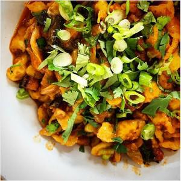

# Kimchi-Bacon-Spätzle

## Ingredients

### Für Spätzle
- 167 g Mehl
- 2 Ei(er)
- 66.7 ml Milch
- 6.67 g Butter, geschmolzene
- Salz

### Für Sauce
- 2 EL Butter
- 120g Bacon
- 1 Zwiebel, gewürfelt
- 1 Dose Kimchi, zerkleinert
- 1EL Gochujang

## Instructions

1. Spätzleteig zusammenwerfen, verrühren. In Wasser kochen bis schwimmt oben. Bei Seite legen und gut trocknen lassen. Spätzle Wasser aufheben.
2. Pfanne erhitzen. Ein EL Butter darin schmelzen und Bacon darin anbraten. Zwiebel und Kimchi dazu und kurz mit anbraten. Inhalt der Pfanne in eine Schüssel geben und mit Gochujang vermischen.
3. Pfanne wieder erhitzen und die Restliche Butter hinzugeben. Spätzle darin kurz bräunen. Dann Zwiebel, Bacon, Kimchi Mischung wieder dazugeben und mit entsprechend Spätzlewasser vermischen bis zufriedenstellende konsistenz. Abschmecken. Essen.
