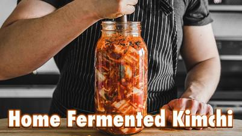

# Kimchi

## Ingredients

### Vegetable Ingredients
- kosher salt for curing
- 1 large napa cabbage (2 lbs 2 oz OR 980g)
- 2 medium sized carrots
- 1 small daikon radish
- 1 bunch green onion

### Paste Ingredients
- 1 large asian pear (250g)
- 6 cloves (20g) garlic, peeled
- 2 inch (82g) piece ginger, peeled
- 1/4 cup (60ml) fish sauce
- 1/3 cup (65g) korean red pepper flakes *be careful with these, if yours are very spicy then reduce the amount to 1/4 cup (52g)*

## Instructions

1. Take your napa cabbage and slice in half lengthwise. Cut each of those halves and cut in half again, making quarters. Cut each of those quarters into 1-inch wide strips.
2. Take your cabbage and place into a large bowl, heavily seasoning it with kosher salt. Squeeze and toss your cabbage really hard, bruising it. Let it sit for at least 30 minutes.
3. While the cabbage is sitting, take your green onions and cut the root bottoms off. Cut the onion into ½-inch segments. Take your carrots and roughly chop them julienne style. Next, peel your medium-sized daikon and cut them like your carrots, but a thicker julienne chop.
4. To make your paste, slice your 2-inch segment of peeled ginger and place into a food processor. Peel and chop an asian pear into cubes and add to the processor. Add in 6 cloves of peeled garlic, and a ¼ cup of fish sauce. Blend until smooth.
5. Transfer paste to a medium-sized bowl and mix together with korean red pepper flakes.
6. After your cabbage has been sitting, drain through a colander and rinse with water while squeezing at the same time. Toss and squeeze until you’ve washed off the majority of the salt.
7. Add your cabbage and all of the vegetables you cut into a large bowl. From there, add in all of your paste and toss to thoroughly coat. Once evenly coated, pack contents into a ½ gallon glass jar that is large enough to fit the mixture. Using a spoon or muddler, press down all of the vegetables so it is packed together, removing any air bubbles in there.
8. Loosely cap the jar off, making sure you don’t tighten it all the way down (for it to release gas) and let it sit for 4-7 days. Make sure to press it throughout this time to remove air bubbles that form throughout.
9. Once your kimchi has reached the desired flavor point, tighten the cap all the way and store it in the refrigerator.
