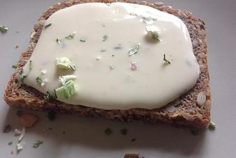

# Kochkäse

## Ingredients

- 200 g Käse (Harzer Roller)
- 200 ml Sahne
- 100 g Butter
- 250 g Quark
- 1 TL Natron

## Instructions

1. Den Harzer Roller klein schneiden und zusammen mit der Butter in der Sahne bei geringer Hitze langsam auflösen. Dabei öfter umrühren. Nach dem Aufkochen den Topf vom Herd nehmen und den Quark dazugeben. Am Ende den knappen Teelöffel Natron unterrühren. Vorsicht - die Masse geht noch hoch!
2. Sofort in ein Aufbewahrungsgefäß umfüllen, abkühlen lassen und über Nacht im Kühlschrank ziehen lassen.
