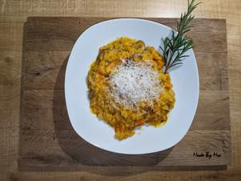

# Kürbis-Pilz-Risotto

## Ingredients

- 250 g Risotto Reis (Arborio, anderer geht auch)
- 1 Hokkaido Kürbis (mittelgroß)
- 400 g Champignons
- 200 ml Sahne
- 1 Zwiebel (groß)
- 1.3 l Gemüsebrühe
- Parmesan
- Butter
- Knoblauch
- Muskat
- Thymian
- Rosmarin
- neutrales Öl

## Instructions

1. Als erstes den Kürbis waschen und in ca. 2 cm große Würfel schneiden. Die Kürbiswürfel mit Knoblauch, Salz, Muskat, Thymian, Rosmarin und Öl vermischen. Auf einem Backblech verteilen und bei 180°C für 20-30 min in den Ofen.
2. Eine große Zwiebel feinhacken und bei mittlerer Hitze anbraten bis die Zwiebeln glasig sind, gut salzen . Die Champignons in grobe Scheiben schneiden, in einem Topf/Pfanne (je nach Risottomenge) in reichlich Butter braten, bis die Flüssigkeit verdampft ist. Danach pro zwei Personen 125g Risotto-Reis hinzufügen. Eine Weile umrühren, bis die Reiskörner vollständig mit Fett umhüllt sind.
3. 1 Liter Gemüsebrühe aufkochen, die Hälfte zum Reis hinzugeben und köcheln lassen bis die Flüssigkeit vollständig absorbiert ist. Jetzt den Kürbis dazu, kurz umrühren und die andere Hälfte Brühe hinzugeben, bis alles komplett mit Brühe bedeckt ist. Kurz aufkochen, dann von der Herdplatte nehmen. Jetzt Pfanne/Topf für 10-15 min (bis der Reis bissfest ist) in den Ofen bei 180°C stellen.
4. Als nächstes ca. 300 ml Gemüsebrühe aufkochen und mit 200 ml Sahne vermischen. Das Risotto aus dem Ofen nehmen und bei mittlerer Hitze auf den Herd stellen. Das Brühe-Sahne Gemisch nach und nach einrühren, dabei darauf achten das die Konsistenz des Risottos nicht zu flüssig wird (Ein Löffel Risotto sollte nicht mehr zerfließen). Den Reis noch 5-10 min umrühren. Zuletzt geriebenen Parmesan und Pfeffer nach Belieben einrühren.

## Notes

von Moe
