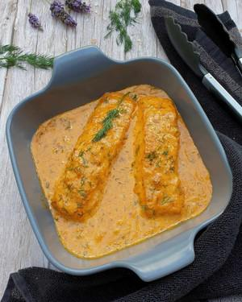

# Lachs-Sahne-Gratin

## Ingredients

### Lachs
- 4 Lachsfilet das sind in etwa 500 g
- Salz, Pfeffer, Paprikapulver Chili Pulver nach Bedarf
- 1 EL Zitronensaft

### Sahne-Sauce
- 1 Zwiebel
- 1 Knoblauchzehe
- 2 EL Öl
- 1 EL Tomatenmark
- 1 EL Mehl
- 200 ml Sahne
- 300 ml Milch
- 1 ½ TL Salz
- 1 TL Pfeffer
- 1 EL Zitronensaft
- ½ Bund Dill Oder 2 EL TK

## Instructions

1. Den Backofen auf 200° Ober-/Unterhitze aufheizen.

### Lachs vorbereiten
2. Als Erstes den Lachs mit Salz, Pfeffer, Paprikapulver und Chili Pulver von beiden Seiten würzen und mit Zitronensaft beträufeln. Tipp: Du kannst den Lachs vorher auftauen lassen. Es funktioniert aber genauso gut mit gefrorenem Lachs, da verlängert sich die Backzeit um 10 Minuten.
3. Den Lachs in eine Auflaufform setzen.

### Sahne-Soße
4. Für die Soße die Zwiebel und den Knoblauch schälen und in feine Würfel schneiden. Den Dill waschen, von den Stielen zupfen und fein hacken.
5. Eine Pfanne mit Olivenöl erhitzen und die Zwiebel und den Knoblauch darin glasig andünsten.
6. Anschließend das Tomatenmark dazugeben und anrösten.
7. Die Sahne in die Pfanne gießen und aufkochen lassen.
8. Mit Salz, Pfeffer und Zitronensaft würzen und 3 Minuten köcheln lassen dann den Dill dazugeben und unterrühren.
9. Die Sahne-Soße üben die Lachsfilets in die Auflaufform geben. Den Lachs in Sahne-Soße für 20 Minuten im Backofen garen.
10. Den Lachs aus dem Ofen holen, mit etwas frischem Dill bestreuen und servieren.
