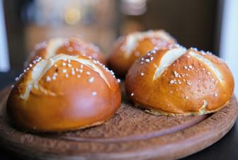

# Laugenbrötchen

## Ingredients

- 250 g Mehl 550 (bitte nur dieses Mehl)
- 12 g Hefe
- 80 ml Milch
- 75 ml Wasser
- 10 g Butter
- ½ TL Zucker
- 1 TL Salz
- 50 g Natron (ich habe Kaiser-Natron verwendet)
- 1.5 l Wasser für Laugenbad

## Instructions
