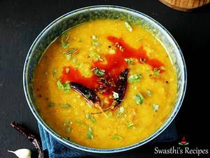

# Masoor Dal

## Ingredients

- 1 cup masoor dal (red lentils)
- 4 tablespoons moong dal (optional)
- 4 medium tomatoes chopped & deseeded
- 2 green chili (optional)
- 2.5 to 3 cup water (for 1¾ cups for IP)

### Tempering
- 2 tablespoon ghee or oil or butter
- 2 red chili broken
- 4 garlic cloves chopped
- 0.5 teaspoon mustard seeds (optional)
- 1 teaspoon cumin seeds
- 2 pinch asafoetida (hing)
- salt as needed
- 0.5 to 1 teaspoon red chili powder
- 0.5 teaspoon turmeric

### optional
- 2 pinch garam masala (or ⅛ tsp) (adjust to taste)
- 0.5 teaspoon kasuri methi (dried fenugreek leaves) or 2 tbsp coriander leaves
- 2 to 4 tablespoons lemon juice for serving

## Instructions

### Stovetop masoor dal
1. Add masoor dal & moong dal (optional) to a pot or pressure cooker. Wash it a few times until the water runs clear.
2. Next add chopped tomatoes, water and green chili.
3. Pressure cook for 1 to 2 whistles on a medium heat. If cooking in a pot, cook on a medium heat until soft adding more water if needed.
4. Once the pressure releases, open the cooker.
5. Mash the dal to suit your liking. You can make it smooth or keep it grainy. If needed you can pour 2 to 3 tbsp water to bring it to a consistency.

### Tempering
6. Heat 1 tbsp ghee in a small pan.
7. Add mustard, cumin, red chilies and garlic.
8. Saute until the garlic turns slightly golden.
9. Turn off the heat and add hing, chili powder and turmeric. You can also add in garam masala if using.
10. Quickly pour this off to the dal. Time to add salt and kasuri methi if using.
11. Mix and simmer for 2 mins. If using coriander leaves add them now.
12. Squeeze in some lemon before serving. Masoor dal is ready to serve with roti or rice.

## Notes

I usually add 2 tbsps of moong dal to this as it gives a thick texture. If using moong dal as well, just use 1/4 cup more water to cook the dal.

For variations you can also add some carrots, spinach, methi leaves to the dal.

You can set aside half of the tadka (tempering) for garnish.
