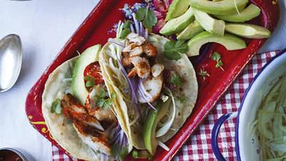

# Mexican Fish Tacos

## Ingredients

- 1 tblsp paprika
- 1 tsp garlic powder
- 1 tsp dried oregano
- 1 tsp cayenne pepper
- 1 tsp ground cumin
- 650g cod fillet
- 1 tblsp sunflower oil
- Sour cream, to serve
- 1 lime, cut into wedges
- 2 avocados, stoned and finely sliced
- Good handful of coriander leaves
- 1 red onion, peeled and finely sliced
- ½ head of white cabbage, finely shredded
- Tabasco sauce
- Sea salt
- 12 x 15cm diameter corn tortillas, warmed through
- Coriander leaves, to serve

### For the Salsa
- 250g cherry tomatoes, halved
- 2 spring onions, trimmed and finely chopped
- 1 garlic clove, peeled and finely chopped
- Juice of 1 lime
- 1 tblsp extra virgin olive oil
- Sea salt and ground black pepper

## Instructions

1. To make the salsa, mix together the ingredients in a serving bowl and set aside.
2. Heat a barbecue or griddle pan to a medium-high heat.
3. Combine the paprika, garlic powder, oregano, cayenne pepper and ground cumin in a bowl.
4. Dust the fish fillet with the spice mix.
5. Brush the grill with the oil and cook the fish for 4–5 minutes on either side until cooked through.
6. Meanwhile, prepare the accompaniments for the fish by arranging the sour cream, lime wedges, avocado slices, coriander leaves, red onion and cabbage in serving bowls. Squeeze a little lime over the avocado and set everything aside on a large serving platter with a little bottle of Tabasco.
7. Carefully remove the fish from the pan and break it apart with a fork. Place the flakes in a serving bowl and season with sea salt to taste. Sprinkle with coriander leaves.
8. Add the warm tortillas to the serving platter and assemble little bits of everything in the tortillas. Wrap up and enjoy!
