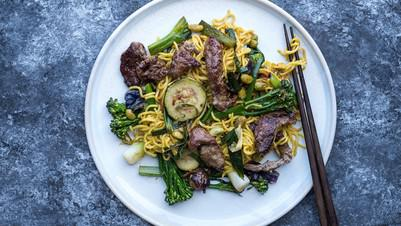

# Mongolian Beef

## Ingredients

- 500g (1lb 2oz) sirloin steak, thinly sliced
- 1 tbsp cornflour
- 3 tbsp sunflower oil
- 3 garlic cloves, crushed
- 2.5cm (1in) piece of ginger, peeled and grated
- 4 spring onions, cut into 2cm (¾in) lengths
- 300g (10oz) bag stir-fry vegetables
- ½ tsp chilli flakes
- 1 tbsp reduced salt soy sauce
- 2 tbsp soft brown sugar
- 275g (9½oz) pack fresh egg noodles

## Instructions

1. Toss the steak strips in the cornflour and some salt and pepper and set aside for 5 minutes. Heat half the oil in a wok or frying pan over a high heat and fry the steak until browned all over. Remove and set aside.
2. Heat the rest of the oil and fry the garlic, ginger and spring onions over a medium heat for 2 minutes.
3. Add the stir-fry vegetables to the pan with a splash of water and fry for 1 minute before adding the chilli flakes, soy sauce and sugar along with 200ml (¾ cup) water. Return the steak to the pan with the noodles and bubble until you have a glossy sauce that coats the noodles. Serve straight away.
