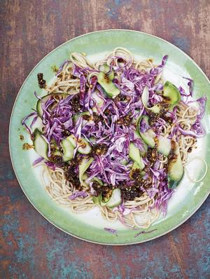

# MOUTH-NUMBING NOODLES with chilli oil and red cabbage

## Ingredients

- For the cabbage pickle /
- 220g red cabbage (about ⅓), finely shredded
- ½ a cucumber, seeds scraped out, sliced thinly
- a handful of fresh mint leaves, chopped
- 4 tbsp rice vinegar
- 1 tbsp toasted sesame oil
- salt
- 1 tbsp sesame seeds
- For the mouth-numbing chilli oil /
- 2 tbsp Sichuan peppercorns
- 4 tbsp chilli flakes
- 6 tbsp rapeseed oil
- 4 cloves of garlic, finely chopped
- 1 tsp caster sugar
- For the noodles /
- 4 tbsp crunchy peanut butter
- 4 tbsp toasted sesame oil
- 400g wholewheat noodles

## Instructions

1. To make the pickle, put the cabbage, cucumber and mint into a bowl, add the vinegar, sesame oil and a pinch of salt, and mix with your hands. Scatter with the sesame seeds and leave to one side.
2. In a blender or spice grinder, blitz the peppercorns and chilli flakes to a rough powder. Heat the rapeseed oil in a small saucepan over a medium flame, then add the garlic and let it sizzle for a minute or two, until it turns a pale gold. Stir in the sugar, ½ teaspoon of salt and the ground peppercorn and chilli mixture, and take off the heat.
3. For the noodles, mix the peanut butter and sesame oil in a bowl with ¹⁄³ teaspoon of salt. Cook the noodles according to the packet instructions, then drain, rinse under cold water and drain again. Put the noodles into a bowl, and add the peanut mixture and 2 table-spoons of chilli oil. Toss with your hands, making sure all the noodles are well coated, then season to taste.
4. To serve, lift the noodles on to a platter (or into four shallow bowls), top with the sharp crunchy cabbage, then add a drizzle of chilli oil, depending on your threshold for mouth-numbing heat.
