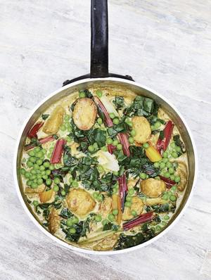

# NEW POTATO, CHARD AND COCONUT CURRY

## Ingredients

- 1 tsp cumin seeds
- 3 cloves of garlic
- 2.5cm ginger, peeled and roughly chopped
- 2 green finger chillies, roughly chopped
- 30g desiccated coconut
- 1 x 400ml tin of coconut milk
- 3 tbsp rapeseed oil
- 1 large onion, halved and thinly sliced
- 600g new potatoes, halved lengthways
- 1½ tsp garam masala
- ½ tsp ground turmeric
- 1 tsp salt
- 200g rainbow chard, stems chopped, leaves shredded
- 250g frozen peas, defrosted

## Instructions

1. Put the cumin, garlic, ginger, chillies and desiccated coconut into a blender with just enough of the coconut milk to blitz everything to a smooth paste. Add the rest of the coconut milk and lightly pulse (over-mixing might split it) to a sauce-like consistency.
2. In a wide frying pan for which you have a lid, heat the oil over a medium flame and fry the onion for 5 minutes, until translucent. Add the potatoes cut side down and fry for around 10 minutes, until they are lightly golden brown and the onions are soft, dark and sticky.
3. Stir in the garam masala, turmeric and salt, then add the coconut sauce and bring up to a gentle bubble. Add the chard stems, cover and cook for 5 minutes. Add the leaves and the peas, cover again and simmer for a final 5 minutes, until the chard stems, peas and potatoes are tender and the leaves have wilted. Serve with basmati rice or chapattis and a fiery pickle on the side.
