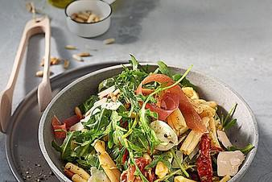

# Nudelsalat Auf Italienisch Von Kreinzru

## Ingredients

### Für den Salat
- 250 g Penne oder andere Nudeln nach Wahl
- 50 g Pinienkerne
- Rucola
- 100 g Tomate(n), getrocknete in Öl
- 200 g Mozzarella
- 150 g Parmaschinken
- Salz und Pfeffer

### Für das Dressing
- 70 ml Olivenöl extra vergine
- 3 EL Balsamico, heller oder dunkler, je nach Geschmack
- 1 Zehe/n Knoblauch
- 1 TL Pesto
- 1 TL Senf
- 1 TL Honig

## Instructions
