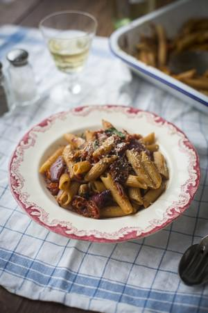

# One Pan Mushy Tomato & Garlic Penne Pasta

## Ingredients

- 200g wholewheat penne
- 1 large bulb of garlic
- 300g of cherry tomatoes
- 1 large red onion
- 2 tbsp of balsamic vinegar
- 2 tbsp of olive oil
- A good pinch of sea salt and ground black pepper
- A large handful of grated Parmesan cheese
- Small handful basil leaves

## Instructions

1. Preheat the oven to 200°C/400°F/Gas Mark 6. Slice the top off the bulb of garlic so that almost all the cloves are exposed. Place the garlic in a large roasting tray.
2. Prepare the cherry tomatoes by slicing them in half. Place the tomatoes in the roasting tray, cut side up. Prepare the red onion by peeling and slicing into rough quarters, place alongside the tomatoes. Drizzle over the balsamic vinegar and olive oil. Sprinkle the tomatoes, garlic and onion with a good pinch of sea salt and black pepper.
3. Give the tray a good shake to ensure everything is evenly coated. Roast in the oven for 30–35 minutes or until the tomatoes have reduced by half their size and the garlic has softened.
4. While the garlic, tomatoes and onion are roasting, bring a medium-sized pot of water to the boil and cook the pasta according to the instructions on the packet.
5. When the tomatoes, garlic and onion are cooked, remove from the oven and, using a fork, carefully push out the garlic cloves from their skins and mash all the ingredients together until you have a thick mushy sauce. Pour a ladle of the pasta cooking water onto the sauce.
6. Drain the pasta and then tumble it into the roasting tray. Add the parmesan cheese and basil. Toss everything together until the pasta is evenly coated. Serve in a large bowl and enjoy!
