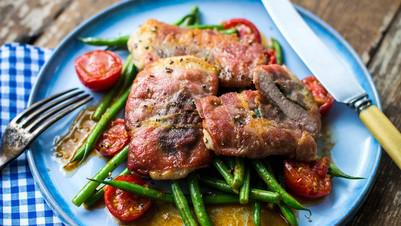

# One Pan Saltimbocca a La Romana

## Ingredients

### For the pork
- 1 tbsp olive oil
- ½ pork fillet
- 6 sage leaves
- 6 slices prosciutto
- 25g plain flour
- Sea salt and black pepper

### For the green beans
- 1 gloves garlic, minced
- 75g cherry tomatoes, halved
- 125g French beans
- 50ml white wine

## Instructions

1. Thinly slice 6 even slices from the pork fillet diagonally. Lay each slice flat on a chopping board and gently bash with a meat hammer or rolling pin until approximately 5mm in thickness.
2. Top each slice with a sage leaf, season with salt and black pepper and wrap with a slice of prosciutto.
3. Place the flour in a wide dish and dredge each slice until completely coated, patting off any excess.
4. Heat a large frying pan over a medium heat and add 1 tbsp oil. Cook the slices for 2 minutes on each side or until the pork has cooked through and the prosciutto becomes crispy.
5. Add the garlic in the pan for a minute or so before adding the cherry tomatoes, green beans and white wine and cook for 4-5 minutes until the beans are tender. You may need to add a splash of water to bring things together.
6. Serve slices of the saltimbocca with the green beans and tuck in.
