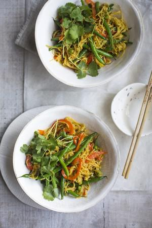

# One Pan Singapore Noodles

## Ingredients

- 1 tbsp sunflower oil
- 3 garlic cloves, finely minced
- 1 large thumb-sized piece of fresh ginger, finely chopped
- 2 red chillies, thinly sliced
- 6 spring onions, thinly sliced
- 200g green beans, trimmed
- 2 red pepper, deseeded and thinly sliced
- 1 tbsp curry powder
- 150g frozen peas
- 3 tbsp dark soy sauce
- 1 tbsp rice wine
- 1 tsp sugar
- 1 tsp sesame oil
- 250g wok noodles
- 500ml boiling hot chicken stock (use veg stock for vegetarian dish)

## Instructions

1. Heat the oil in a large wok over a high heat and stir-fry the garlic, ginger, chilli and spring onions for 2 minutes until the onions are just tender.
2. Add the green beans and red pepper and stir-fry for a further 4 minutes before stirring in the curry powder, frozen peas, soy sauce, rice wine, sugar and sesame oil.
3. Roughly break in the noodles and pour over the chicken stock, making sure the noodles are completely submerged. Continue to stir until the noodles are tender; which should only take a couple of minutes, by which time the liquid should also have evaporated.
4. Serve in deep bowls with a generous sprinkle of coriander.
