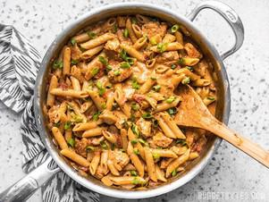

# One Pot Creamy Cajun Chicken Pasta

## Ingredients

### CAJUN SEASONING
- 2 tsp smoked paprika
- 1 tsp oregano
- 1 tsp thyme
- 1/2 tsp garlic powder
- 1/2 tsp onion powder
- 1/4 tsp cayenne pepper
- 1/4 tsp black pepper
- 1/4 tsp salt

### CHICKEN PASTA
- 1 Tbsp olive oil
- 1 Tbsp butter
- 1 lb. boneless, skinless chicken breast
- 1 yellow onion, diced
- 1/2 lb. penne pasta
- 15 oz. fire roasted diced tomatoes
- 2 cups chicken broth
- 2 oz. cream cheese
- 3 green onions, sliced

## Instructions

1. Combine the ingredients for the Cajun seasoning in a small bowl. Cut the chicken into 1/2 to 3/4-inch cubes. Place the cubed chicken in a bowl, pour the Cajun seasoning over top, and stir to coat the chicken in spices.
2. Add the olive oil and butter to a large deep skillet. Heat the oil and butter over medium-high until the skillet is very hot and the butter is melted and foamy. Add the seasoned chicken to the skillet and cook for a couple minutes on each side, or just until the outside gets some color. The chicken does not need to be cooked through at this point.
3. Add the diced yellow onion to the skillet and continue to sauté for about 2 minutes more, or just until the onion begins to soften. Allow the moisture from the onion to dissolve any browned bits from the bottom of the skillet.
4. Next, add the pasta, fire roasted diced tomatoes (with the juices), and chicken broth to the skillet. Stir just until everything is evenly combined, then place a lid on top and allow the broth to come up to a boil.
5. Once boiling, turn the heat down to medium-low and let the pasta simmer for about ten minutes, stirring every couple of minutes, until the pasta is tender and the liquid is thick and saucy.
6. Add the cream cheese to the skillet in chunks, then stir until it has melted into the sauce. Top the pasta with sliced green onions and serve.

## Notes

The deep skillet I use is a 4-quart capacity.

Depending on your cookware, you may need to adjust the heat up or down to maintain a simmer in the broth. Be sure to stir often to prevent the pasta from sticking.
