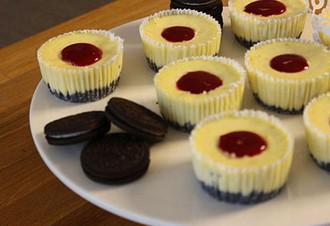

# Oreo-Cheesecake-Muffins

## Ingredients

### BODEN
- 120 g Oreo Kekse
- 50 g Butter (flüssig)

### KÄSEMASSE
- 400 g Frischkäse (Doppelrahmstufe)
- 100 g Zucker
- 200 g Crème fraîche
- Zitrone (Abrieb)
- 2 Eier
- Vanilleextrakt

### HIMBEERSPIEGEL
- 70 g Himbeeren (TK)
- 1 TL Speisestärke
- 1 EL Zucker
- 40 ml Wasser

## Instructions

1. Eine Muffinform mit Papierbackförmchen auslegen. Die Kekse mit einem Mixer fein zerbröseln oder mit dem Ausrollstab zerkleinern. Mit der zerlassenen Butter vermischen. Diese Bröselmasse in die Papierförmchen geben und sehr glatt drücken. Das geht am besten mit einem Holzstab.
2. Frischkäse, Zitronenschalenabrieb, -saft, Eier, Creme Fraiche, Zucker und Vanille mit einem Schneebesen kurz verrühren, ohne Luft einzuschlagen. Die Käsemasse in die Muffinförmchen verteilen. Muffinform auf die Arbeitsfläche klopfen, damit die Luftbläschen entweichen. Die Muffins bei 150°C Ober- und Unterhitze für etwa 20-22 Min. backen, in der Mitte sind sie dann noch etwas wackelig, aber diese werden nach dem Abkühlen fest. In der Form erkalten lassen und dann stürzen. Das geht am besten mit einem Abkühlgitter oder einer Platte. In den Kühlschrank stellen.
3. Mit einem kleinen Löffel die Mitte der Muffins raus kratzen.
4. Für den Himbeerspiegel die Stärke mit dem Wasser verrühren, alle Zutaten kurz aufkochen, durch einen Sieb streichen und die Muffins damit befüllen. Abgekühlt servieren.
