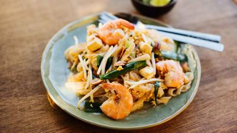

# Pad Thai

## Ingredients

- 200g Banh Pho Nudeln
- 2 Schalotten
- 2 Knoblauchzehen
- 1 Frühlingszwiebel
- 1 Zucchini
- 180g Tofu
- 50g Preserved Radish (eingemachter Rettich)
- 4 Eier
- 4 Esslöffel geröstete Erdnüsse
- 100g Mungbohnenkeimlinge
- 1 Limette

### SAUCE
- 1 EL Kokosblütenzucker
- 1 TL Tamarindenmark
- 4 EL Fischsauce
- ½ Teelöffel rote Chiliflocken (nach Geschmack)
- 200ml Wasser
- Öl zu Braten

## Instructions

1. Die Nudeln in lauwarmen Wasser für 15 Minuten einweichen.
2. Die Schalotten und die Frühlingszwiebeln klein schneiden.
3. Den Knoblauch schälen und feinhacken.
4. Den Tofublock und die Zucchini in 0,5cm Würfel schneiden und mit Speisestärke verrühren.
5. Den Rettich mit dem Foodprocessor kleinhacken.
6. Die Eier in einer Schale aufschlagen und verquirlen.
7. Die Erdnüsse im Mörser grob zerstoßen.
8. Die Mungbohnenkeimlinge waschen und putzen.
9. Die Nudeln aus dem Wasser nehmen und abtropfen lassen.
10. Die Limette in Achtel schneiden.
11. Für die Saucenmischung Kokosblütenzucker, Tamarindenmark, Fischsauce und die Chiliflocken zusammen mit 200ml Wasser in einer Schale verrühren.
12. Eier mit Butter in der Pfanne warm werden und stocken lassen. Zur Seite stellen.
13. Die Pfanne auf mittlerer Stufe erhitzen, 2 EL Öl hineingeben. Die Schalotten und die Frühlingszwiebeln andünsten. Tofu, Zucchini und Rettich dazu geben. Zum Schluss den Knoblauch hinzugeben. Darauf achten, dass nichts braun wird.
14. Jetzt die Nudeln hinzugeben und alles gründlich vermischen.
15. Die Saucenmischung dazugeben und wieder gründlich vermischen.
16. Die Nudeln sollten jetzt weich werden, aber nicht matschig. Sie dürfen aber auch nicht mehr zäh sein. Gegebenenfalls noch etwas heißes Wasser zugeben.
17. Schliesslich die Mungbohnenkeimlinge, das Rührei und die Erdnüsse hinzufügen.
18. Alles nochmals gründlich vermischen und mit Limette abschmecken. Eventuell noch mit etwas Chiliflocken nachwürzen.
