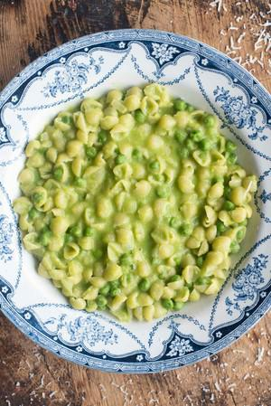

# Pasta e Piselli

## Ingredients

- 1 tablespoon olive oil extra virgin
- 1/2 cup onion chopped into small dice
- 2 cups frozen peas
- 4 cups water divided
- 170 grams small pasta ditalini or small shells
- 3 tablespoon parmigiano reggiano grated
- salt and pepper to taste

## Instructions

1. To a large pan or pot, over medium heat, ada the olive oil.
2. Once olive oil is heated through, add the chopped onion. Season with salt and pepper.
3. Once onion is fragrant, add the peas. Cook for about 1-2 minutes. Pour in about 2.5-3 cups of water.
4. Once water and peas come to a boil, remove about 1 ½ cup of peas and a bit of broth to a measuring cup or jar.
5. Using an immersion blender, blend the peas until creamy.
6. Add the cream mixture back into the pan. Adjust for salt and pepper if needed.
7. Once it comes back to a boil, add in the pasta.
8. Cook the pasta until tender. If while cooking, it starts to dry out too much, add more water. Stir often, or else the pasta and peas will stick to the bottom of the pan. Remove from heat.
9. Off heat, add a bit of olive oil and grated parmigiano. Stir. This will give the dish an even creamier consistency.
