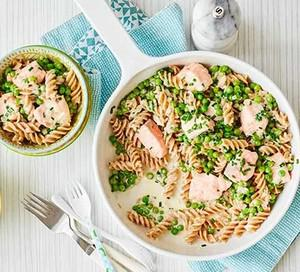

# Pasta with Salmon & Peas

## Ingredients

- 400g wholewheat fusilli
- knob of butter
- 2 large shallot, finely chopped
- 250g frozen peas
- 4 skinless salmon fillets, cut into chunks
- 200g Creme cheese
- ½ low-salt vegetable stock cube
- small bunch of chives, snipped
- Dill
- Lemon Juice
- Parmesan

## Instructions

1. Bring a pan of water to the boil and cook the fusilli according to the pack instructions.
2. Meanwhile, heat a knob of butter in a saucepan, then add the shallot and cook for 5 mins or until softened.
3. Add the peas, salmon, crème fraîche and 50ml water. Crumble in the stock cube.
4. Cook for 3-4 mins until cooked through, stir in the chives and some black pepper. Then stir through to coat the pasta. Serve in bowls.
