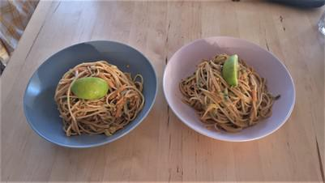

# Peanutbutter-Garlic-Noodles

## Ingredients

- 160 g lange Nudeln (ob Spaghetti oder Asianudeln ist egal)
- 2 Karotten
- 1/2 Salatgurke
- 1 Paprika

### Für die Soße
- 4 EL Erdnussbutter (gerne mit Stückchen)
- 1 Zehen Knoblauch
- 2 EL Sojasoße
- 2 EL Sesamöl
- 2 EL Essig (am besten Reisessig)
- 2 EL Chilisoße (z.B. Sriracha)
- 1 daumengroßes Stk Ingwer
- 1 EL Honig, Agavendicksaft oder Zucker

## Instructions

1. Wasser für Nudeln aufsetzten
2. Knoblauch und Ingwer reiben, pressen oder sehr fein hacken. Ein Mixer funktioniert z.B super und ist für den kommenden Arbeitsschritt auch durchaus praktisch.
3. Mit den restlichen Zutaten der Soße (Erdnussbutter, Sojasoße, Öl, Essig, Chilisoße, Wasser, Honig) vermengen.
4. Karotten, Paprika und Gurke waschen; Paprika und Gurkeentkernen. Wenn ihr filigran mit dem Messer unterwegs seid, dann alles in gleichmäßige Streifen schneiden. Wir benutzen lieber die Reibe, geht schneller und lässt sich später besser vermengen.
5. Soße und Gemüsestreifen in eurer größten Salatschüssel (da müssen später noch die Nudel reinpassen) vermengen
6. Nudeln kochen (wie das funktioniert sollte bekannt sein)
7. Nudeln abgießen. Vorher etwas Nudelwasser abschöpfen, das kann dann genutzt werden sollte die Soße zu dickflüssig sein.
8. Nudeln in die Schüssel mit den restlichen Zutaten geben und alles gut durchmischen.
9. Dazu passt super ein bisschen Limette und/oder Lauchzwiebeln

## Notes

von Marius und Charlotte

Im Prinzip kann jegliches Gemüse rein was euch rohschmeckt.
