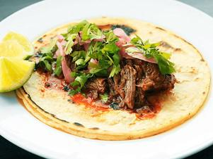

# Pickled Red Onions

## Ingredients

- 2 jalapeño pepper, cut into 1/4-inch rings
- 6 large red onions, finely sliced (about 1 quart)
- 70 ml concentrated vinegar
- 3 teaspoons kosher salt
- 630 ml water
- 200 g sugar

## Instructions

1. Place jalepeño and onions in a medium mixing bowl. Heat vinegar, water, sugar, and salt in a small skillet over high heat, whisking until sugar is dissolved. Bring to a boil, then pour over onions. Press onions down with a spoon until submerged. Place a double layer of paper towels on top of onions and press down until completely saturated in liquid to keep onions submerged. Allow to sit until onions are softened and liquid has cooled, about 25 minutes. Onions will keep indefinitely in a sealed container in the refrigerator.
