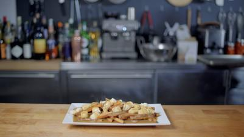

# Poutine

## Ingredients

- 2-3 lbs russet potatoes
- Kosher salt
- Freshly ground pepper
- Vegetable oil, for frying
- Cheese curds (or fresh mozzarella for substitute)
- 3 Tbsp unsalted butter
- 3 Tbsp all purpose flour
- 2-3 cups homemade stock (see below)

### For the sorta-homemade stock
- 1 carton of store-bought stock
- 1 carrot, chopped into large pieces
- 1 large onion, halved
- 1 shallot, halved
- 1 head garlic, halved
- 1 two-inch piece of ginger, peeled
- ½ bunch parsley
- 4 sprigs thyme
- Soy sauce (to taste)
- Worcestershire sauce (to taste)

## Instructions

1. Fries
2. Slice 2-3 pounds of Russet potatoes into french fry shapes, leaving the skin on for a more rustic presentation. Rinse all the starch off the potatoes by tossing them in a bowl until the water runs clear. Very thoroughly dry potatoes using a lint free cloth. Wet food in hot oil can cause the oil to bubble and potentially burn you!
3. In batches, put extra dry potatoes into a vat of vegetable oil heated to 350 degrees Fahrenheit for about 5-7 minutes until potatoes start to turn light blonde. Put onto a paper towel lined baking sheet until they cool to room temperature. Place in the freezer for at least 4 hours.
4. Take fries out of the freezer and throw into 400 degree Fahrenheit oil until they are crisp and golden brown. Cooking time will vary, so keep an eye on them. Drain on a wire rack and then dump into a bowl to season with Kosher salt. Toss thoroughly to ensure all fries are salted.
5. Sorta-Homemade Stock
6. Pour a glug of your cooking oil of choice into a saucepan and heat over medium high heat until shimmering. Add vegetables to brown. The more dark brown color on the vegetables, the more flavor that will be added to the stock. Once nice and brown, add a carton of store bought stock and some fresh herbs like parsley and thyme. Cook for one hour and strain.
7. Gravy
8. Put 3 tbsp of unsalted butter into a clean saucepan and bring to a bubble before adding 3 tbsp of all purpose flour. Whisk and cook for about a minute until a light-blonde roux is formed.
9. Slowly stream stock into the roux, whisking constantly to make sure no lumps or clumps can form. Once all of the stock is in the saucepan, add in a few splashes of soy sauce and Worcestershire sauce. Season with salt and pepper to taste.
10. Simmer and cook down until a gravy-like consistency is reached.
11. Poutine Assembly
12. Place fries onto plate.
13. Top fries with cheese curds (or tear off little chunks of mozzarella and roll into balls if cheese curds are not available).
14. Pour gravy over the fries and cheese. Enjoy!
