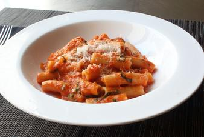

# Rigatoni Al Segreto (Rigatoni with Secret Sauce)

## Ingredients

- 4 tablespoons olive oil
- 1 cup diced onion
- 1 teaspoon salt, plus more to taste
- 2 cloves garlic, crushed (or more to taste)
- 1 pinch red pepper flakes
- 1 (28 ounce) can San Marzano (Italian) tomatoes, blended smooth
- ½ cup water (to rinse out can of tomatoes)
- 1 (8 ounce) package uncooked rigatoni pasta
- ½ cup fresh basil leaves, thinly sliced
- 4 tablespoons cold butter, cubed
- 1 cup grated Parmigiano-Reggiano cheese, plus more for serving

## Instructions

1. Heat olive oil in saucepan over medium-high heat. Add onions, salt. Cook until no longer white and starting to turn translucent, about 5 minutes. Stir in garlic; cook about 1 minute. Add chili flakes and blended tomato sauce. Bring to a simmer; adjust heat to medium to medium-low. Simmer gently, stirring occasionally, for 45 to 60 minutes. Reduce heat to low.
2. Bring a large pot of lightly salted water to a boil. Cook rigatoni in the boiling water, stirring occasionally until tender yet firm to the bite, about 8 minutes (5 minutes from doneness).
3. Add about 2/3 of the basil to the sauce. Stir in butter. When butter melts, add cheese in 3 increments.
4. Drain pasta; transfer to sauce. Stir until rigatoni are evenly coated with sauce. Serve sprinkled with the remaining basil and a dusting of grated cheese.

## Notes

This recipe probably makes enough sauce to coat 12 oz of pasta, but I like lots of sauce.
