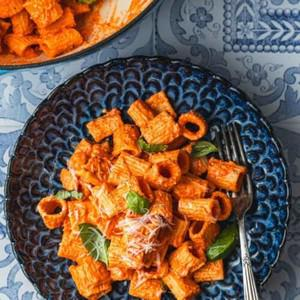

# Roasted Red Pepper Pasta

## Ingredients

- 12 ounces ridged rigatoni
- Extra virgin olive oil
- 4 large garlic cloves, crushed and peeled
- 3 large roasted red peppers, homemade or 15-ounce jar roasted red peppers
- 1/2 cup whole milk or milk of your choice
- 1/2 teaspoon dried oregano
- 1/2 teaspoon Spanish paprika, sweet or smoked
- Kosher salt
- Black pepper
- 1/4 cup grated parmesan, more to your liking
- Handful fresh basil leaves, torn, for garnish (optional)

## Instructions

1. Boil the pasta. Bring a large saucepan of water (about 4 quarts) to a rolling boil and season generously with kosher salt (about 1/2 to 1 tablespoon). Add the pasta and bring back to boil. Stir occasionally until the pasta is cooked to al dente according to package instructions, about 9 to 10 minutes. Reserve 1 cup of the pasta cooking water before draining.
2. Soften the garlic. While the pasta is cooking, heat about 2 tablespoons of olive oil over medium heat until just shimmering. Add the garlic and stir until fragrant, about 30 seconds. Transfer the garlic and olive oil to the bowl of a large food processor fitted with a blade.
3. Add the roasted peppers. If you roasted the peppers yourself, remove the skin and seeds and roughly chop. If you’re using a jar, drain them well and pat them dry. Add the peppers to the food processor, along with the milk, oregano, paprika, and a big pinch of salt and pepper (about 1/2 teaspoon each). Blend until smooth.
4. Combine the pasta and sauce. When the pasta is ready, remember to reserve about 1 cup of the cooking water and drain. Return the pasta to the saucepan and pour the sauce over top. Turn the heat to low and add the parmesan. Stir to mix well so the pasta is fully coated in the sauce. Mix in the reserved pasta water, a splash at a time, as necessary until the pasta is nicely glossy (you likely won’t need all of the water).
5. Serve. Divide the pasta among serving bowls and top with fresh basil and more parmesan cheese, if you like.
6. Video
