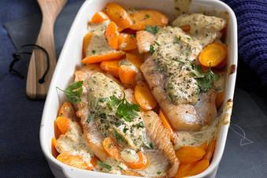

# Rotbarsch-Filet Mit Möhren Und Senfcreme

## Ingredients

- 500 g Möhre(n)
- 20 g Butter
- Salz und Pfeffer aus der Mühle
- 100 ml Gemüsebrühe
- ½ Bund Petersilie
- 125 g Crème fraîche
- 1 EL Senf
- 350 g Rotbarschfilet(s)

## Instructions

1. Die Backröhre auf 200 °C Ober-/Unterhitze vorheizen. Eine flache Auflaufform ausbuttern.
2. Die Möhren schälen und in schräge Scheiben schneiden. Ca. 4 - 5 Minuten in Butter andünsten. Mit Salz und Pfeffer würzen. Die Gemüsebrühe angießen, und in ca. 5 Minuten zugedeckt fertig garen.
3. Die Petersilie, bis auf etwas zum Garnieren, fein schneiden und mit Crème fraîche und Senf vermischen. Mit Salz und Pfeffer würzen. Den Fisch salzen und pfeffern.
4. Die Hälfte der Möhren in die Auflaufform geben und die Hälfte der Senfsoße darauf verteilen. Die Fischfilets darauf legen und übrige Möhren und restliche Creme darauf verteilen. Im Ofen auf der zweiten Schiene von unten ca. 15 Minuten backen.
