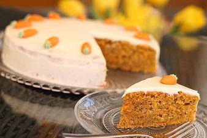

# Rüblikuchen

## Ingredients

### Für den Teig
- 375 g Möhre(n), gerieben
- 250 g Mehl
- 2 TL Backpulver
- 250 g Zucker
- 1 TL Zimtpulver
- 250 ml Öl, neutrales
- 4 Ei(er)
- 200 g Mandel(n), gemahlen
- Fett für die Form

### Für das Frosting
- 300 g Frischkäse
- 100 g Puderzucker
- 1 Pck. Vanillezucker
- 1 Spritzer Zitronensaft

## Instructions

1. Eier, Zucker, Öl und Zimt mit dem Mixer verrühren. Die Karotten und Mandeln hinzugeben. Mehl und Backpulver mischen, ebenfalls unterrühren. Den Teig in eine gefettete 26er Springform füllen, bei 180 °C Ober-/Unterhitze 40 - 50 Minuten backen. Man sollte eine Stäbchenprobe machen und die Erfahrungswerte mit dem eigenen Backofen berücksichtigen.
2. Für das Frosting Frischkäse und Zitronensaft mit dem Mixer auf niedriger Stufe glatt rühren. Puderzucker und Vanillezucker einrieseln lassen.
3. Nach dem Backen den Kuchen abkühlen lassen. Das Frosting mit der Streichpalette rundherum auftragen.
