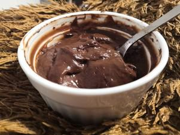

# Schokopudding

## Ingredients

- Päckchen Vanillepuddingpulver
- 500 ml Milch
- 30 g Zucker
- 20 g Backkakao
- Etwas Schokostückchen
- Salz

## Instructions

1. Wie angegeben, aber Kakao und Salz vorher mit dem Vanillepuddingpulver vermischen. In den fertigen Pudding die gewünschte Menge an Schokostückchen einrühren.
