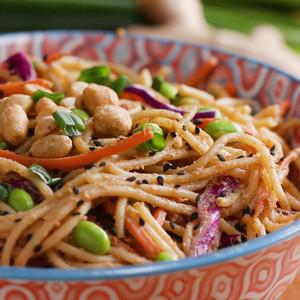

# Sesame Peanut Noodles Recipe by Tasty

## Ingredients

- ½ cup peanut butter (120 g)
- 3 tablespoons low-sodium soy sauce
- 2 tablespoons sesame oil
- 2 tablespoons rice vinegar
- 3 tablespoons water
- 2 ½ teaspoons brown sugar
- 1 clove garlic
- ½ tablespoon minced fresh ginger
- 8 oz dried spaghetti noodles (240 g), cooked according to package instructions and drained
- ½ cup shredded carrots (55 g)
- ½ cup shredded red cabbage (50 g)
- ¾ cup shelled edamame (115 g)
- chopped peanut, for garnish
- 1 tablespoon black sesame seeds, for garnish
- thinly sliced scallion, for garnish

## Instructions

1. In a blender, combine the peanut butter, soy sauce, sesame oil, rice vinegar, water, brown sugar, garlic, and ginger and blend until smooth.
2. In a large bowl, combine the spaghetti, carrots, cabbage, and edamame, then pour over the peanut sauce. Use tongs to toss well until the sauce is fully incorporated.
3. Divide the noodles between serving bowls and garnish with peanuts, black sesame seeds, and scallions.
4. Enjoy!
