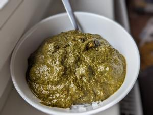

# Shakarkandi Palak

## Ingredients

## Instructions

### Süßkartoffeln
1. 1 große Süßkartoffel neutrales Speiseöl etwas Salz und Garam Masala

### Pürierter Spinat
2. 500g Spinat 2 grüne Chilis, in feine Scheiben geschnitten ½ Cup Cashews

### Gewürzmischung
3. 2 TL Kreuzkümmelsamen 4 Kardamom 1-2 cm Zimt 3-4 Nelken 1-2 Birds Eye Chilies

### Masala
4. Gewürzmischung 1 Cup Zwiebel, fein gewürfelt 1 Daumen Ingwer, gerieben 3 Knoblauchzehen, fein gehackt/gerieben 300g Tomaten, fein gewürfelt Garam Masala

### Zum Abrunden
5. 1-2 TL Kasoori Methi ~80ml Sahne

## Notes

Süßkartoffel-Spinat-Curry

Süßkartoffeln:

Die Süßkartoffeln schälen und in 2-3cm große Würfel schneiden. Die Süßkartoffeln leicht salzen.

Öl bei mittlerer Hitze in einer Pfanne/Topf erhitzen. Die Süßkartoffeln dazugeben und unter Wenden braten bis sie gar sind. Kurz vor Ende Garam Masala dazugeben. Süßkartoffeln aus dem Topf nehmen und beiseite stellen.

Pürierter Spinat:

Spinat gut reinigen und alles außer Blätter aussortieren. Etwas Öl in einer Pfanne erhitzen. Spinat, Chilis und Chashews in die Pfanne geben. Gegebenenfalls Spinat in mehrere Ladungen einarbeiten. Solange erhitzen bis der Spinat sein Wasser abgegeben hat. Das Wasser muss nicht ganz verdampft sein.

Die Spinat Mischung mit etwas Wasser in einen Mixer geben. So lange mixen bis eine dickflüßige "Sauce" entsteht. Bei Bedarf mehr Wasser hinzufügen.

Gewürzmischung:

Die ganzen Gewürze in einem Topf (ohne Öl!) kurz "rösten". Man sollte das Aroma gut riechen können. Vorsicht: Chili kann ein sehr aggressives Aroma haben und zu lange rösten ist nicht gut für die Gewürze. Gewürze per Mörser/Mühle zu einem feinen Pulver verarbeiten.

Masala:

Öl in einer Pfanne erhitzen. Zwiebel darin glasig braten.

Ingwer und Knoblauch kurz mitanbraten. Nach einer Minute die Gewürzmischung hinzufügen.
