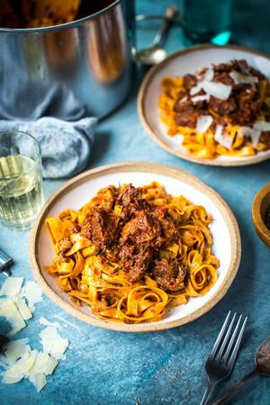

# Slow-Cooked Beef Ragu

## Ingredients

- 4 tbsp olive oil
- 1.5kg braising steak (beef shin or cheek is especially delicious), cut into large pieces
- 2 tbsp plain flour
- 1 large onion, finely chopped
- 1 carrot, finely chopped
- 2 celery sticks, finely chopped
- 3 garlic cloves, thinly sliced
- 2 bay leaves
- 3 thyme sprigs
- 250ml white wine
- 2 x 400g tins chopped tomatoes
- Squidge of tomato puree
- 100ml full-fat milk
- 400g dried pappardelle
- Extra-virgin olive oil
- Sea salt and black pepper
- Parmesan or pecorino shavings, to serve

## Instructions

1. Heat half the oil in a large shallow casserole over a medium–high heat while you season the beef and dust it in the four. Shake off any excess and add the beef to the casserole in batches, browning it on all sides. Remove from the casserole with a slotted spoon and set aside.
2. Add the remaining oil to the casserole and fry the onion, carrot and celery for 5–6 minutes until softened, then add the garlic, bay leaves, thyme sprigs and white wine. Bubble for 2–3 minutes then return the beef to the casserole with the chopped tomatoes, tomato purée and milk. Season well.
3. Bring to the boil then reduce the heat and simmer gently, uncovered, for 2 hours, adding a splash of water or chicken stock if it starts to look too dry. The beef should be lovely and tender and give when you push it with the back of a spoon.
4. When the cooking time is almost up, cook the pasta in boiling salted water for 8–10 minutes or until al dente then drain and drizzle with extra-virgin olive oil. Shred the meat into the sauce then serve the ragu on top of the pasta, scattered with lots of shavings of Parmesan or pecorino.
