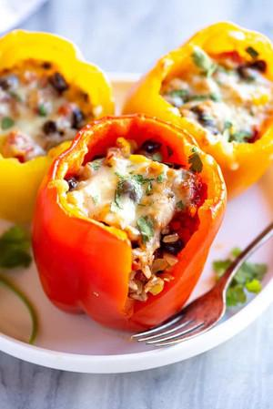

# Southwest Vegetarian Stuffed Peppers

## Ingredients

- 6 sweet bell peppers (red, yellow, or orange)
- 1 1/2 cups cooked rice (white, brown, cauliflower rice or quinoa)
- 1 Tbsp olive oil
- 1 small onion , diced
- 3 garlic cloves , minced
- 1 14.5 ounce can diced tomatoes with green chiles , mild
- 1 14 oz can black beans , drained and rinsed
- 1 cup frozen corn
- 2 green onions , chopped
- 1 tsp chili powder
- ½ teaspoon ground cumin
- 1 tsp kosher salt , plus more to taste
- 1/4 black pepper , plus more to taste
- 1 1/2 cups shredded cheese , Mexican blend or pepperjack cheese, divided
- ¼ cup chopped fresh cilantro

## Instructions

1. Preheat oven to 400 degrees F.
2. Cut ¼-inch from tops of bell peppers and remove the stem, ribs and seeds.
3. Fill a large baking dish with 1/2-inch of water.
4. Place peppers cut-side down in the water and bake for 20 minutes.
5. Heat oil in a 12-inch skillet over medium-high heat. Add onion and cook until softened, about 5 minutes. Add garlic and cook for 30 seconds. Add corn, beans, diced tomatoes, green onions, chili powder, cumin, salt, and pepper. Stir until corn and beans are heated through, about 5 minutes.
6. Remove skillet from heat and stir in rice, 1 cup cheese, and cilantro. Stir to combine. Taste and add additional seasonings, if needed.
7. Remove peppers from oven and drain water from dish. Divide the mixture evenly between the peppers, then top with remaining cheese. Return to oven for 10-15 more minutes, until peppers are tender and cheese is melted.
8. Store leftover peppers in the refrigerator, covered for 4-5 days.

## Notes

Peppers: Choose big, round bell peppers so there is plenty of room for stuffing them, and pick ones with four bumps on the bottom so they sit flat in the baking dish.

To make-ahead: These stuffed peppers can be make 1-2 days ahead of time. Make the recipe through step 6, fill the peppers with filling, top them with cheese but wait to bake them again until you are ready to serve them.

To store: Store the peppers in the refrigerator, covered for 4-5 days.

To freeze: Make the stuffed peppers through step 6, fill the peppers with filling and top them with cheese. Once they've cooled completely, place them in a freezer safe container or ziplock in the freezer for 2-3 months. Allow them to thaw in the refrigerator overnight and bake as directed in step 7.
