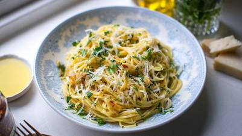

# Spaghetti Aglio E Olio

## Ingredients

- 200g best quality dried spaghetti
- 3 tbsp extra virgin olive oil
- 3 garlic cloves, sliced thinly
- ½ tsp dried red chilli flakes
- A small handful flat-leaf parsley, finely chopped
- 25g Parmesan cheese, finely grated, plus extra for garnish
- Sea salt

## Instructions

1. Place a large pot of water over a high heat and bring to the boil. Add a generous seasoning of salt.
2. Cook the spaghetti for 9-12 minutes or until al dente. Drain the pasta, reserving a cup or so of the liquid and place back in the pot.
3. Place a large frying pan over a medium high heat and add the olive oil. Add the garlic while the oil is still coming to temperature and cook until slightly golden for 4-5 minutes. Add in the red chilli flakes a fry for a further 1 minute.
4. Add the oil with garlic and chilli flakes, reserved cooking water, Parmesan cheese and chopped parsley to the cooked pasta and toss until the pasta is evenly coated.
5. Serve straight away with more grated Parmesan cheese.
