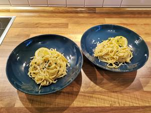

# Spaghetti al Limone

## Ingredients

- 150 g Spaghetti
- 1 Bio Zitrone
- 1 Knoblauchzehe
- 1/2 Bund Petersilie
- 25 g Parmesan
- 1 EL Butter
- 1 Ei
- 1 TL Gewürzpaste für Gemüsebrühe/Gemüsebrühwürfel
- 2 EL Olivenöl
- Salz, Pfeffer und Zucker

## Instructions

1. Wasser für die Spaghetti aufkochen.
2. Die Zitrone heiß abwaschen, Schale abreiben, 2 Scheiben beiseitelegen und den Saft auspressen.
3. Den Knoblauch schälen und fein würfeln/pressen. In einem kleinen Topf das Olivenöl mit dem Knoblauch erhitzen und kurz anbraten. Mit 250ml Wasser ablöschen, die Gewürzpaste einrühren und zusammen mit dem Zitronensaft bei mittlerer Temperatur ca. 8 Minuten auf etwa die Hälfte einkochen lassen.
4. Spaghetti mit 1 EL Salz in das kochende Wasser geben und nach Packungsanleitung bissfest garen.
5. In einer Schale den geriebenen Parmesan mit dem Ei und der gehackten Petersilie vermengen. Von der Petersilie etwas zur Seite stellen.
6. Die eingekochte Brühe vom Herd nehmen und mit der Zitronenschale, 1⁄2 TL Zucker und der Butter vermengen.
7. Die Spaghetti am Ende der Kochzeit abgießen und zurück in den Topf geben. Die Parmesan-Ei-Mischung und die eingekochte Brühe zügig unterheben und alles gut vermengen. Nach Geschmack mit Salz und Pfeffer würzen.
8. Die „Spaghetti al Limone“ auf Tellern anrichten und mit den Zitronenscheiben, sowie der zur Seite gestellten Petersilie garnieren. Wir wünschen guten Appetit!

## Notes

von Jenny und Christopher

In diesem Sinne wünschen wir euch beiden zur Hochzeit nochmals nur das Beste. Möge eure Ehe aus

Geben und Nehmen, sowie einander Halten und miteinander Teilen bestehen!
