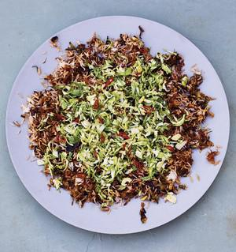

# Sprout Nasi Goreng

## Ingredients

- 350g jasmine rice
- 3 tbsp rapeseed oil
- 1 red onion, chopped
- 4 cloves of garlic, crushed
- 3 bird’s-eye chillies, very finely chopped
- 750g Brussels sprouts, very finely sliced
- 2 tbsp tomato puree
- 2 tbsp kecap manis
- 1¼ tsp salt, plus extra to taste
- 2 tbsp soy sauce
- 2 tbsp white wine vinegar
- 2 tbsp toasted sesame oil
- 1 tsp caster sugar

## Instructions

1. Place the rice in a sieve and rinse under a cold tap until the water runs clear. Tip the rice into a pan, add 600ml of freshly boiled water and bring to the boil. Place the lid on, then turn the heat down to a whisper and cook for 15 minutes. Take off the heat and leave to steam with the lid on.
2. To cook the nasi goreng base, heat the rapeseed oil in a large frying pan on a medium flame and fry the onion, stirring, for 5 minutes. Add the garlic and two-thirds of the chopped chillies, cook for 2 minutes more, then add all but two large handfuls (or about 150g) of the sprouts. Fry for 8 minutes, leaving them undisturbed for a couple of minutes at a time, so they get some colour on them. Then stir in the tomato puree, kecap manis, salt and a tablespoon each of soy sauce and vinegar. Cook for another 5 minutes, then take off the heat.
3. To make the marinated sprouts, put the remaining raw sliced sprouts into a bowl with 1 tablespoon of soy sauce, 1 tablespoon of vinegar, the sesame oil, sugar and the remaining chopped chillies. Mix very well and set aside.
4. To finish the nasi goreng, put the sprout and onion pan on a medium heat and gently scoop in the steamed rice, folding it in until well mixed. Heat through, stirring gently, for 5 minutes, until the rice is nice and hot, and season with salt to taste. Transfer to a big platter, scatter the marinated sprouts over the top, and serve.
