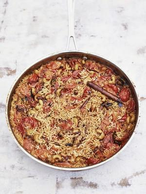

# SUMMER PILAU with tomato, coconut and cashews

## Ingredients

- 350g basmati rice
- 2 tbsp rapeseed oil
- 12 fresh curry leaves
- 4cm cinnamon stick
- 1 large onion, finely sliced
- 4 cloves of garlic, crushed
- 1 green finger chilli, finely sliced
- 50g unsalted cashews
- 400g baby plum tomatoes, halved
- 1 x 400ml tin of coconut milk
- 1¾ tsp salt
- Lime, Lorbeerblatt statt curryblätter

## Instructions

1. Wash the rice in a few changes of cold water until the water runs clear, then leave to soak in plenty of cold water.
2. Meanwhile, heat the oil in a wide frying pan and add the curry leaves and cinnamon stick. Stir-fry for a minute, then add the onion and cook for around 10 to 12 minutes, until it starts to turn golden brown and is soft enough to cut with a wooden spoon. Add the garlic, chilli and cashews, and cook for a couple of minutes, then add the tomatoes and pop the lid on. Cook for around 8 minutes, until the tomatoes are soft and jammy around the edges.
3. Drain the rice, add it to the pan and stir to combine. Add the coconut milk, 200ml of water and the salt. Stir again and bring the mixture to the boil, then pop the lid on, turn the heat down to a whisper and cook for a further 15 minutes. Don’t be tempted to lift the lid as the steam is key to cooking the rice. Once the 15 minutes is up, take off the heat and keep the lid on for a further 10 minutes to let the rice rest before eating. Serve alongside a fresh green salad.
