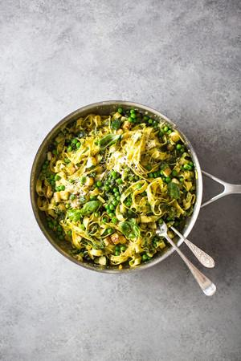

# Super Green Pesto Pasta

## Ingredients

- 50g basil leaves
- 30g Parmesan cheese, grated, plus extra to serve
- 50g pine nuts, plus extra to serve
- 1 large garlic clove
- 85ml extra-virgin olive oil, plus extra for frying
- 2 courgettes, diced
- 300g frozen peas
- 500g fresh tagliatelle

## Instructions

1. In a food processor blitz the basil with the Parmesan, pine nuts and garlic, season well with salt and pepper and gradually whizz in the oil until you have a glossy pesto.
2. Heat a little oil in a frying pan and fry the courgettes for 2–3 minutes until lightly coloured. Add the frozen peas and allow to defrost and warm through.
3. Cook the pasta in a saucepan of boiling salted water for 2–3 minutes, then drain and add to the pan of veg along with the pesto. Serve with a scattering of pine nuts and Parmesan.
