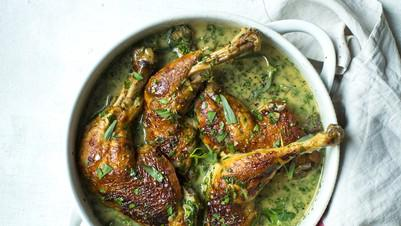

# Tarragon Chicken

## Ingredients

- 2 tbsp olive oil
- 4 chicken legs
- 1 large onion, thinly sliced
- 1 head of garlic, cloves separated and peeled
- 3-4 tarragon sprigs
- 600 ml white wine
- 500 ml chicken stock
- Splash of double cream or crème fraîche
- Handful of chopped flat-leaf parsley
- Sea salt and black pepper

## Instructions

1. Preheat the oven to 200C (180C fan). Heat the oil in a large casserole over a medium-high heat. Season the chicken all over, add it to the casserole and brown in the oil, then remove and set aside.
2. Add the onion to the casserole and cook gently for 10 minutes until softened. Add the garlic cloves, chicken, taragon, white wine and stock and bring to the boil.
3. Cover with a lid, transfer to the oven and cook for 45 minutes. Remove the lid and cook for a further 20 minutes or until the chicken is very tender.
4. Transfer the chicken to a serving dish to rest, then return the casserole to a medium-high heat and bubble the sauce away a little more until it coats the back of a spoon.
5. Add the cream or crème fraîche, check the seasoning then stir in the parsley. Spoon the sauce over the chicken and serve.
