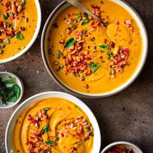

# Thai Pumpkin Soup

## Ingredients

### Roasted Pumpkin
- 3 pound (1.3 kg) pumpkin or winter squash (we like kabocha squash best)*
- ½ tablespoon coconut oil, or neutral-flavored oil of choice
- ½ teaspoon kosher salt
- ½ teaspoon white pepper
- ¼ teaspoon ground cinnamon

### Soup
- 1 ½ tablespoons coconut oil, or neutral-flavored oil of choice
- 3 large shallots, chopped (or 1 small yellow onion)
- 6 garlic cloves, chopped
- 2 inch piece ginger, grated or minced (okay to leave peel on)
- 2 stalks fresh lemongrass** outer papery layers removed, then minced
- 1 teaspoon cumin seeds (or ¾ teaspoon ground cumin)
- 1 teaspoon coriander seeds (or ¾ teaspoon ground coriander)
- 1 teaspoon white pepper (or freshly cracked black pepper)
- ¼ teaspoon ground cinnamon
- ¼ teaspoon ground turmeric
- 1 13.5-ounce (400 mL) can full-fat coconut milk
- 2 tablespoons red curry paste
- 3 cups (720 mL) vegan “chicken” broth (or good-quality vegetable broth)***
- 12 dried Makrut lime leaves or 6 fresh lime leaves****
- 1 ½ tablespoons coconut sugar or organic brown sugar
- 1 tablespoon + 1 teaspoon Thai soy sauce (or 2 TBSP + 1 tsp regular soy sauce)
- 1 handful of Thai basil leaves, chopped or torn

### For serving
- Crusty bread, toasted
- Peanut Chile Crunch (optional, see next recipe card)

## Instructions

1. Prep the pumpkin. Preheat the oven to 400ºF/205ºC. Using a sharp knife, slice the pumpkin or squash in half. If it’s too difficult, microwave the whole thing for 2 minutes to soften. Scoop out the seeds using a spoon or ice cream scoop.
2. Roast the pumpkin. Mix together the ½ tbsp of the oil, salt, white pepper, and cinnamon in a small bowl until it’s almost like a paste. Use a pastry brush or your hands to brush inside the cavities of the pumpkin/squash only, but not on the top outer rims. For the top outer rims, just brush lightly with oil (no spices, or they will burn). Place the pumpkin halves, flesh side down, on a rimmed sheet pan. Prick the skin with a knife to allow venting. Roast until the pumpkin is very soft, about 40 to 45 minutes.
3. Crush the spices. Using an electric spice grinder or mortar and pestle, grind up the cumin and coriander seeds but don’t fully grind, leaving a little texture. Stir in the white pepper, cinnamon, and turmeric for your spice blend. If you don’t have either, crush them using the back of a heavy mug or a cast iron skillet, or add them to a ziploc and roll back and forth with a rolling pin or smash with a mallet.
4. Make the soup. Heat a medium saucepan over medium-high heat with the 1 1/2 tbsp coconut oil. Once hot, add the shallots, garlic, ginger, and lemongrass with a pinch of salt, and cook for 3 to 4 minutes, or until shallots and garlic just start to get some color. If it starts to stick, add a splash of water to scrape up the food bits. Add the spice mix and stir almost constantly for 30 seconds.
5. Add a few tablespoons of the coconut milk to deglaze the pot and pick up the food bits. Once it’s bubbling, add the curry paste. Fry the paste for a few minutes, tossing frequently to prevent sticking or burning. Pour in the rest of the coconut milk and deglaze the pot more as needed. Add the broth, lime leaves, sugar, and soy sauce. Bring to a boil. Reduce heat to a simmer, and simmer for 10 minutes. Scoop out the lime leaves but keep them for now.
6. Blend the soup. When the roasted pumpkin is still warm, scoop out the flesh using a large spoon or peel the skin with your hands (it will come off easy). Transfer the flesh to the blender; discard the skin. Add the warm soup and blend until smooth and creamy. Taste the soup. If you want a stronger flavor from the lime leaves, add a few to the soup and blend again (you need a fairly powerful blender). Note: if your blender container is smaller than 64 ounces, blend in two batches.
7. Rest for 15 minutes to meld the flavors. Transfer to bowls andgarnish each bowl with a handful of Thai basil leaves and a few spoons of Peanut Chile Crunch, if using.

## Notes

For ingredient substitutions, please read the Ingredient Notes section or FAQ section in the blog post. To keep gluten-free, use tamari instead of soy sauce.

We love the velvety texture and nutty flavor of kabocha squash here. Butternut squash also works great. A sugar pie pumpkin works, but it had the least flavor and texture in comparison.

* To prepare lemongrass, first, cut off the tough bottom nub and several inches from the top. Then peel papery outer layers until you have a tender inner core; mince that part.

** A “no-chicken” vegan broth added the most flavor, but you can also sub with regular vegetable broth. Our favorite brand of broth with excellent flavor is Imagine Organic.

*** If using fresh lime leaves, lightly bruise or crush the leaves with your hands to release more aroma. For dried leaves, just gently crumple them.
