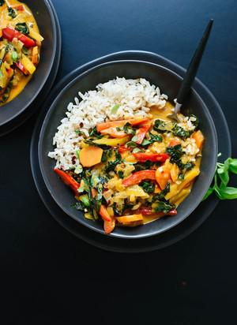

# Thai Red Curry Recipe with Vegetables

## Ingredients

- 1 ¼ cups brown jasmine rice or long-grain brown rice, rinsed
- 1 tablespoon coconut oil or olive oil
- 1 small white onion, chopped (about 1 cup)
- Pinch of salt, more to taste
- 1 tablespoon finely grated fresh ginger (about a 1-inch nub of ginger)
- 2 cloves garlic, pressed or minced
- 1 red bell pepper, sliced into thin 2-inch long strips
- 1 yellow, orange or green bell pepper, sliced into thin 2-inch long strips
- 3 carrots, peeled and sliced on the diagonal into ¼-inch thick rounds (about 1 cup)
- 2 tablespoons Thai red curry paste*
- 1 can (14 ounces) regular coconut milk**
- ½ cup water
- 1 ½ cups packed thinly sliced kale (tough ribs removed first), preferably the Tuscan/lacinato/dinosaur variety
- 1 ½ teaspoons coconut sugar or turbinado (raw) sugar or brown sugar
- 1 tablespoon tamari or soy sauce***
- 2 teaspoons rice vinegar or fresh lime juice
- Garnishes/sides: handful of chopped fresh basil or cilantro, optional red pepper flakes, optional sriracha or chili garlic sauce

## Instructions

1. To cook the rice, bring a large pot of water to boil. Add the rinsed rice and continue boiling for 30 minutes, reducing heat as necessary to prevent overflow. Remove from heat, drain the rice and return the rice to pot. Cover and let the rice rest for 10 minutes or longer, until you’re ready to serve. Just before serving, season the rice to taste with salt and fluff it with a fork.
2. To make the curry, warm a large skillet with deep sides over medium heat. Once it’s hot, add the oil. Add the onion and a sprinkle of salt and cook, stirring often, until the onion has softened and is turning translucent, about 5 minutes. Add the ginger and garlic and cook until fragrant, about 30 seconds, while stirring continuously.
3. Add the bell peppers and carrots. Cook until the bell peppers are fork-tender, 3 to 5 more minutes, stirring occasionally. Then add the curry paste and cook, stirring often, for 2 minutes.
4. Add the coconut milk, water, kale and sugar, and stir to combine. Bring the mixture to a simmer over medium heat. Reduce heat as necessary to maintain a gentle simmer and cook until the peppers, carrots and kale have softened to your liking, about 5 to 10 minutes, stirring occasionally.
5. Remove the pot from the heat and season with tamari and rice vinegar. Add salt (I added ¼ teaspoon for optimal flavor), to taste. If the curry needs a little more punch, add ½ teaspoon more tamari, or for more acidity, add ½ teaspoon more rice vinegar. Divide rice and curry into bowls and garnish with chopped cilantro and a sprinkle of red pepper flakes, if you’d like. If you love spicy curries, serve with sriracha or chili garlic sauce on the side.

## Notes

Recipe adapted from my Thai green curry recipe.

RED THAI CURRY PASTE: Look for it in the Asian section of the grocery store. I like Thai Kitchen brand, which is vegetarian. Not all brands are (they can contain fish sauce and/or shrimp paste).

*COCONUT MILK: For rich and creamy curry, you need to use regular (not light/reduced fat) coconut milk that contains guar gum. My favorite is Native Forest Classic. The varieties without guar gum (which are becoming more widely available) aren’t nearly as creamy, even though their fat content is the same.

**MAKE IT GLUTEN FREE: Be sure to use gluten-free tamari instead of regular soy sauce.
