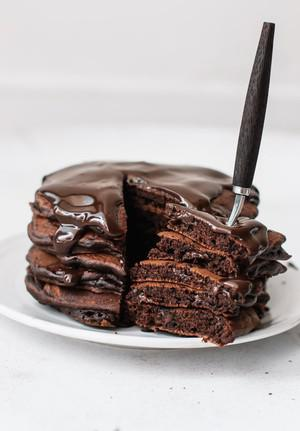

# The Most Amazing Chocolate Pancakes

## Ingredients

### Pancakes
- 1 1/3 cups (185g) all-purpose flour
- 1/4 cup (25g) cocoa powder (I use Dutch-processed)
- 2 teaspoons baking powder
- 1/4 teaspoon salt
- 2 eggs
- 1/3 cup (65g) granulated sugar
- 1 cup (240 ml) whole milk
- 3 tablespoons canola or vegetable oil (or 45g melted butter)
- 1 teaspoon pure vanilla extract
- 1/2 cup (85g) chocolate chips or chunks
- butter or oil , for cooking

### Chocolate Ganache Sauce
- 140 g (5 oz.) bittersweet or semisweet chocolate
- 1/2 cup (120 ml) heavy cream

## Instructions

1. In a large bowl, sift together flour, cocoa powder, baking powder with a fine mesh strainer, and salt (or whisk well with a whisk). Set aside.
2. In a separate medium bowl, whisk together egg and sugar until well combined. Add milk, oil (or melted butter), and vanilla extract. Pour the wet ingredients into the dry ingredients and stir just until combined and moistened using a rubber spatula or whisk. Do not over mix. Mix in chocolate chips or chunks. Set batter aside and make the chocolate sauce.
3. Chocolate sauce: In a medium heatproof bowl, combine chocolate and heavy cream. Microwave in 20- to 30-second increments, mixing in between, until chocolate is melted and mixture is smooth. You can also melt the chocolate in a stainless steel bowl set over simmering water in a medium saucepain, creating a double boiler. Set aside while making the pancakes. I like to pour it over the pancakes while it’s warm.
4. Cook the pancakes: Heat a griddle or skillet over medium heat. Coat with butter or oil. For each pancake, drop 1/4 cup of batter onto skillet. Cook 1-2 minutes, until surface of pancakes have some bubbles and the bottom appears to be done. Flip carefully and cook another 1-2 minutes. Transfer to a plate and if you want you can cover the plate loosely with aluminum foil to keep warm. Coat the skillet with butter or oil before every pancake or batch of pancakes to prevent sticking.
5. Serve immediately with chocolate sauce (rewarm sauce in the microwave for a few seconds if needed).
