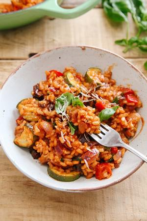

# Tomato & Roasted Mediterranean Vegetable Risotto (Vegan)

## Ingredients

### For the roasted vegetables
- 1 tbsp olive oil
- 300 g cherry tomatoes
- 2 red peppers
- 1 large courgette, zucchini
- A generous pinch of salt and pepper

### For the risotto
- 1 tbsp olive oil
- 1 large onion, diced
- 3 garlic cloves, minced
- 250 g risotto rice
- 1 tbsp balsamic vinegar
- 350 ml passata
- 400 ml vegetable stock
- Approx 6 sun-dried tomatoes, chopped into small chunks (oder 100g mehr frische Tomaten
- A small bunch of fresh basil, torn
- salt and pepper, to taste
- Optional vegan parmesan or "nooch", to serve

## Instructions

### To roast the vegetables
1. Preheat the oven to 180C / 350F and add the olive oil to a roasting tin.
2. Chop the vegetables into small chunks and spread out in the tin, adding the salt and pepper before giving everything a shake to coat.
3. Roast for 30 minutes.

### To make the risotto
4. Meanwhile, add olive oil to a shallow casserole dish or large frying pan, on a low-medium heat.
5. Sauté the onion for a few minutes before adding the minced garlic and cooking for another minute.
6. Stir in the rice with the vinegar and stir for approx 30 seconds, to coat it in the oil.
7. Pour in the passata and vegetable stock, 1/2 cup at a time, alternating between the two. Allow each amount to be absorbed by the rice before adding the next.
8. After 20 minutes, add in the sundried tomatoes and the roasted vegetables. Give everything a stir, adding more liquid if needed, and cook for a further 5 minutes until everything is cooked through and the rice is done.
9. Remove from the heat and stir in the basil, salt and pepper and vegan cheese (if using). Feel free to stir in any extra oil or dairy-free butter at this point for an extra creamy risotto.
10. Serve right away and enjoy!

## Notes

mehr Gemüse!
