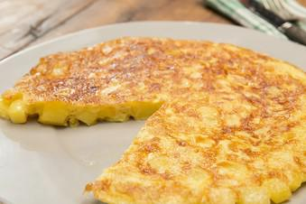

# Traditionelle Spanische Tortilla Von Fanes

## Ingredients

- 750 g Kartoffeln, vorwiegend festkochende
- 1.5 TL, gestr. Salz
- 375 ml Olivenöl
- 225 g Zwiebel(n)
- 6 Ei(er)
- 1.5 Prise(n) Salz
- 3 EL Olivenöl zum Braten

## Instructions
