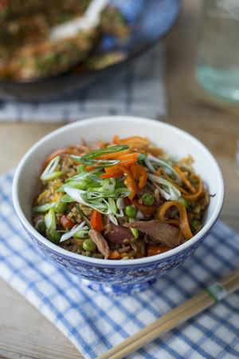

# Ultimate Leftover Fried Rice

## Ingredients

- 1 tbsp sunflower oil
- 2 garlic cloves, peeled and finely grated
- 1 red chilli, deseeded and finely chopped
- 1 thumb-sized piece of fresh ginger, peeled and finely grated
- Bunch of spring onions, thinly sliced
- 2 large carrots, peeled and thinly sliced
- 1 red pepper, deseeded and finely chopped
- 1 tsp sesame oil
- 1 tbsp soy sauce
- 1 tbsp Thai fish sauce (Nam Pla)
- 150g cooked ham hock meat, finely chopped
- 150g frozen peas
- 300g leftover cooked rice, cold
- 2 large free-range eggs, lightly whisked.

## Instructions

1. Heat the sunflower oil in a large frying pan and stir-fry the garlic, chilli and ginger for 1 minute.
2. Add the spring onions, carrots and red pepper and stir-fry for a further 3 minutes.
3. Stir through the sesame oil, soy sauce and Thai fish sauce over the heat for 1 minute.
4. Add the ham and peas and gently mix through.
5. Add the cooked rice to the pan and mix to combine with the vegetables and ham.
6. Make a well in the centre and pour in the whisked egg. Allow to set briefly, then, working quickly, stir the egg and quickly incorporate the rice from the sides until everything is combined.
7. Cook for 2 minutes then serve straight away in a big bowl for a quick and tasty dinner.

## Notes

A cheap and healthy option full of punchy Asian flavours!
