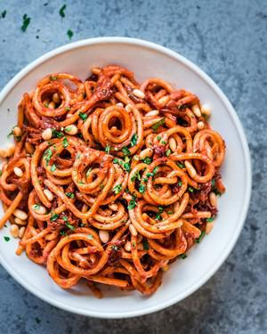

# Vegan Caramelized Onion Pasta

## Ingredients

- 2 tablespoons extra virgin olive oil
- 2 medium yellow onions, very thinly sliced
- Water to deglaze the pan
- 4 garlic cloves, thinly sliced
- Kosher salt or sea salt to taste
- Freshly cracked black pepper to taste
- 1 teaspoon red pepper flakes
- 1 teaspoon dried oregano
- 1 5.3-ounce (150g) tube of tomato paste (not canned tomato paste)
- 2 tablespoons tamari (or soy sauce)
- 2 tablespoons nutritional yeast
- 4 - 5 large oil-packed sundried tomatoes, finely chopped
- 10 ounces (285g) spaghetti or linguine (can use gluten-free)

### Optional garnishes
- Toasted pine nuts; chopped flat-leaf Italian parsley

## Instructions

1. Heat a 12-inch skillet or Dutch oven somewhere between medium-high and high heat. Add the olive oil, and once it’s hot, add the thinly sliced onions and season with salt and pepper. Stir frequently and cook the onions until a light brown fond starts to form on the surface of the pan, about 5 minutes. Add a few spoons of water to deglaze the pan. Continue cooking the onions, adding more water every few minutes and stirring frequently to prevent burning, until they’re deeply golden brown, about 15 minutes.
2. Reduce the heat to medium and stir in the sliced garlic cloves. Stir frequently, adding water as needed to deglaze. Cook for another 5-10 minutes until the onions are fully caramelized and the garlic is golden and soft.
3. Add the red pepper flakes and oregano, and stir to coat the onions, about 30 seconds. Add the tomato paste and stir constantly, or until the paste has caramelized and become darker, 2-3 minutes.
4. Add the tamari, nutritional yeast, and chopped sundried tomatoes and stir to combine. Turn the heat to low.
5. Ladle a few spoons of the reserved pasta water into the caramelized onions. Then transfer the hot cooked pasta to the onions. Use a pair of tongs to swirl the pasta into the sauce, adding more pasta water as needed (I usually add ¾-1 cup) until you can coat all of the noodles in the tomato-y sauce. This whole process usually takes 3-4 minutes.
6. If desired, garnish with pine nuts and chopped parsley. Leftovers stay good in an airtight container for 2-3 days.

## Notes

more onion
