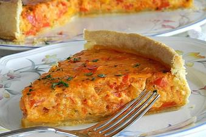

# Vegetarische Paprika-Zwiebel-Quiche

## Ingredients

### Für den Mürbeteig
- 200 g Mehl
- 100 g Butter
- 1 Ei(er)
- 1 Schuss Mineralwasser
- 1 Prise(n) Salz
- Fett für die Form

### Für den Belag
- 3 Paprikaschote(n), rote
- 3 kleine Zwiebel(n)
- 2 Ei(er)
- 200 g Käse, gerieben
- 120 g Ajvar, scharf oder mild
- 1 EL Tomatenmark
- 100 g Crème fraîche
- Salz und Pfeffer

## Instructions

1. Aus dem Mehl, der Butter, einem Ei, Mineralwasser und etwas Salz einen Mürbeteig kneten. Danach den Teig in Klarsichtfolie einrollen und im Kühlschrank ca. 1 Stunde ziehen lassen.
2. Jetzt die roten Paprikaschoten entkernen und fein würfeln. Zwiebeln ebenfalls schälen und fein würfeln. Das Gemüse in einer Pfanne bei geschlossenem Deckel so lange anschwitzen, bis es glasig ist. Das dauert ca. 20 Minuten, danach den Herd abschalten und etwas abkühlen lassen.
3. Anschließend den Mürbeteig aus dem Kühlschrank holen, ausrollen und eine gefettete 26-er Springform damit auskleiden. Den Boden mit einer Gabel mehrfach einstechen.
4. Paprika, Zwiebel, Eier, Käse, Ajvar, Tomatenmark und Crème fraîche miteinander vermischen und mit Salz und Pfeffer abschmecken. Die Masse gleichmäßig in der Springform verstreichen.
5. Jetzt die Quiche bei 190 °C Ober-/Unterhitze ca. 40 Minuten backen.
6. Etwas abkühlen lassen vor dem Servieren.
