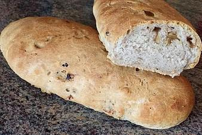

# Walnuss-Ciabatta

## Ingredients

- 375 g Weizenmehl
- 1 Packung Hefe
- 225 ml Wasser, lauwarm
- 65 g Walnüsse
- 1 ½ EL Olivenöl
- 1 TL Salz

## Instructions

1. Das Mehl in die Rührschüssel geben. Die Hefe mit knapp 300 ml lauwarmem Wasser anrühren. Die Walnüsse klein brechen oder hacken.
2. Hefewasser, Walnüsse, Olivenöl und Salz unter das Mehl mischen, kräftig zu einem Teig kneten und zugedeckt 2 Stunden ruhen lassen.
3. Den Teig mit Mehl bestreuen, nochmals durchkneten und zu zwei Rollen formen. Die Rollen an beiden Enden packen und zu länglichen Laiben ziehen. Auf ein Backblech mit Backpapier legen, mit einem leicht angefeuchtetem Tuch abdecken und 30 Minuten gehen lassen, bis die Laibe ihr Volumen verdoppelt haben.
4. Den Backofen auf 200 °C Heißluft vorheizen und die Ciabattas darin in 25 Minuten hellbraun backen (mehrmals kräftig mit Wasser besprühen).
