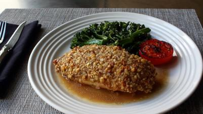

# Walnut-Crusted Chicken Breast

## Ingredients

- 5 cloves garlic, crushed
- 3 tablespoons Dijon mustard, divided
- 2 teaspoons fresh thyme
- 2 (8 ounce) skinless, boneless chicken breast halves
- salt and freshly ground black pepper to taste
- cayenne pepper to taste
- 1 1/2 cups finely chopped walnuts
- 1 tablespoon olive oil, or to taste
- 1/2 cup chicken broth
- 2 teaspoons honey

## Instructions

1. Mix garlic, 2 tablespoons Dijon mustard, and thyme together in a bowl to make the "nut glue."
2. Season chicken breasts generously with salt, pepper, and cayenne. Spread nut glue all over the chicken. Refrigerate until ready to use.
3. Toss walnuts over the chicken, press down firmly, and repeat on the other side to coat thoroughly. Refrigerate for 1 1/2 to 3 hours.
4. Preheat the oven to 375 degrees F (190 degrees C).
5. Coat the bottom of an oven-proof skillet with some olive oil. Place chicken breasts on top, reserving excess nuts if desired. Season with a pinch of salt and drizzle more olive oil on top.
6. Bake in the center of the preheated oven until walnuts are lightly toasted and an instant-read thermometer inserted into the thickest part of a breast reads 150 degrees F (66 degrees C), about 25 minutes.
7. Quickly remove chicken to a plate to rest. Transfer skillet to the stovetop; stir in broth, 1 tablespoon Dijon mustard, and honey and bring to a boil over high heat; cook until reduced by about half, 3 to 4 minutes. Spoon pan sauce over and around the chicken to serve.

## Notes

You can prep the chicken hours ahead if you prefer.

Be careful taking the pan out of the oven and keep the handle covered with a towel or mitt at all times.
