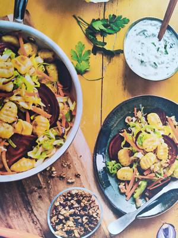

# Wintergemüse-Gnocchi-Pfanne

## Ingredients

- 800 g Gnocchi (Kühlregal)
- Salz
- 2 rote Zwiebeln
- ½ Spitzkohl
- 2 Möhren
- 1 Stange Lauch
- 50 g Walnüsse
- 2 EL Rohrzucker
- ½ Bund Schnittlauch
- ½ Bund Petersilie
- 200g Frischkäse/Quark/Creme fraiche
- Pfeffer
- Zitronensaft
- Zucker
- 3 EL Rapsöl
- Muskatnuss

## Instructions

1. Gnocchi gegebenenfalls (Packungsanweisung beachten) in Salzwasser al dente kochen.
2. Zwiebeln schälen, in feine Streifen schneiden. Kohl putzen, in Streifen schneiden. Möhren schälen und stifteln. Lauch der Länge nach halbieren, gut waschen und in halbe Ringe schneiden.
3. Walnüsse grob hacken und mit Rohrzucker in einer Pfanne unter Rühren rösten, sodass der Zucker leicht karamellisiert.
4. Für den Dip Kräuter hacken und unter den Quark rühren. Dip mit Salz, Pfeffer, Zitronensaft und einer Prise Zucker abschmecken.
5. 2 EL Öl in einer großen Pfanne erhitzen. Das Gemüse, außer die Rote Bete, portionsweise unter Rühren 5 Minuten garen, sodass es noch leichten Biss hat. Mit Salz, Pfeffer und Muskatnuss würzen.
6. Gemüse aus der Pfanne nehmen und Gnocchi im restlichen Öl kurz gold braun braten. Dann das Gemüse und Frischkäse wieder zugeben, unter die Gnocchi mischen und alles nochmals mit Salz und Pfeffer würzen. Mit Walnüssen servieren.
